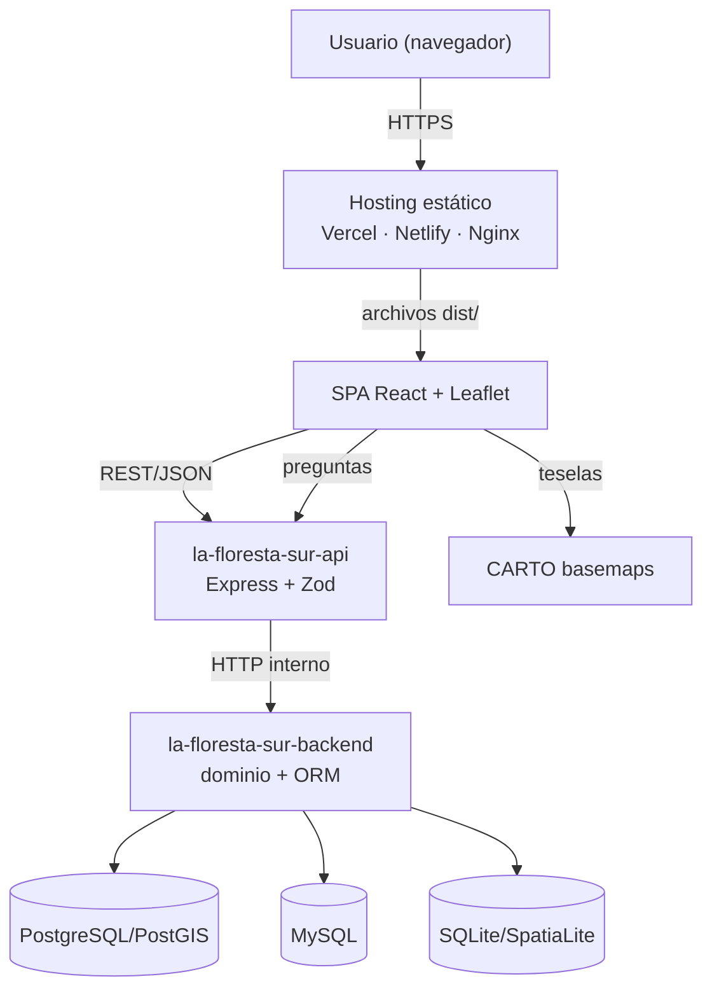
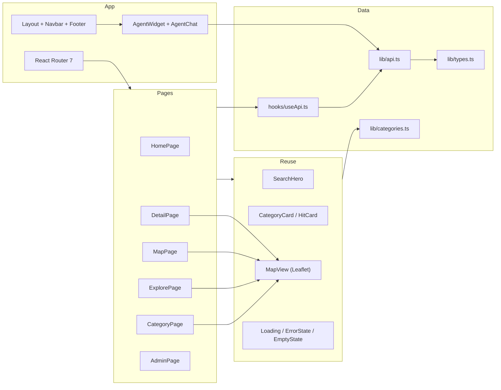
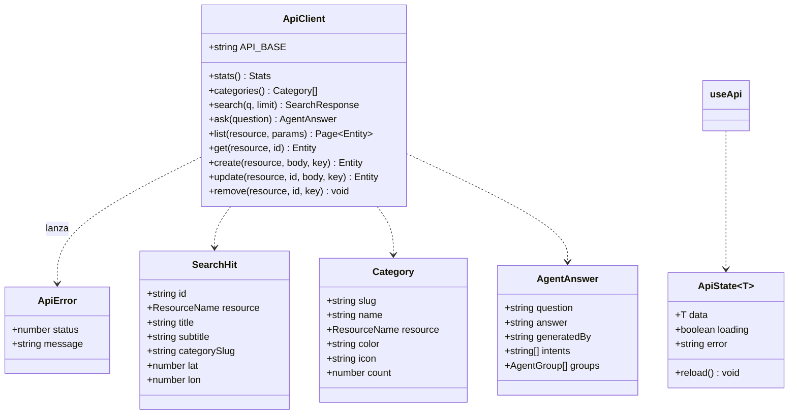
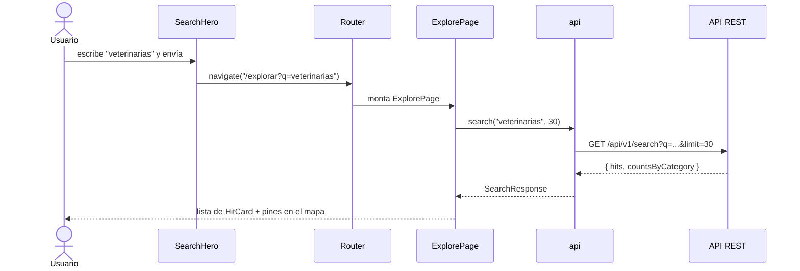
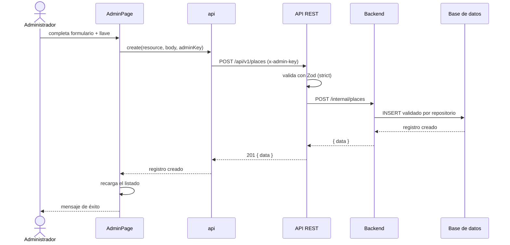
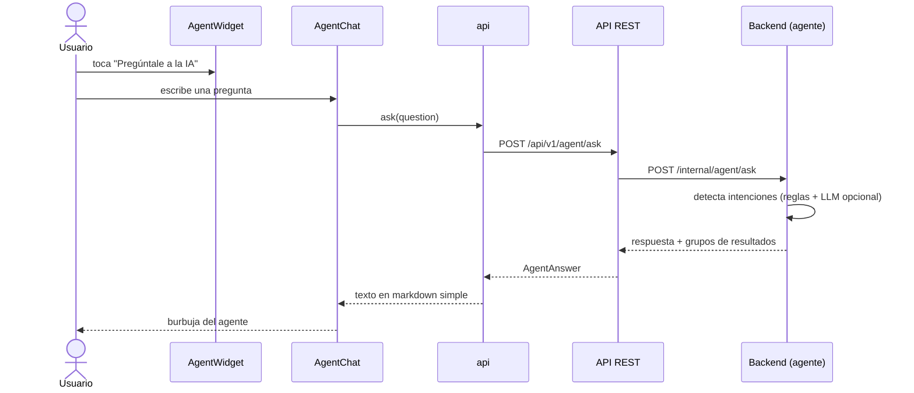

# Arquitectura del frontend

El frontend es la capa de presentación del sistema **La Floresta Sur**. Consume únicamente el
contrato REST de `la-floresta-sur-api`; nunca habla directo con la base de datos.

## 1. Capas internas

```text
pages/        vistas por ruta (composición)
components/   UI reutilizable y accesible
hooks/        estado remoto (useApi)
lib/          cliente HTTP, tipos, catálogo de categorías, formato
```

Regla de dependencia: `pages -> components -> lib`. Ningún archivo de `lib/` importa componentes.

## 2. Diagrama de despliegue



## 3. Diagrama de componentes



## 4. Diagrama de clases (cliente)



## 5. Secuencia: búsqueda



## 6. Secuencia: CRUD administrativo



## 7. Secuencia: agente de IA



## 8. Decisiones de diseño

- **Un solo endpoint base** (`VITE_API_URL`): la SPA no conoce detalles del backend.
- **useApi** centraliza carga, error y recarga; las páginas no repiten `useEffect`.
- **Catálogo de categorías** (`lib/categories.ts`) desacopla iconos/colores del backend y sirve de
  respaldo si `/categories` falla.
- **Mapa único** (`MapView`) recibe `SearchHit[]`, así sirve para búsquedas, categorías, detalle y
  la vista de capas.
- **Agente flotante** vive en `Layout`, por lo que está presente en todas las vistas.
